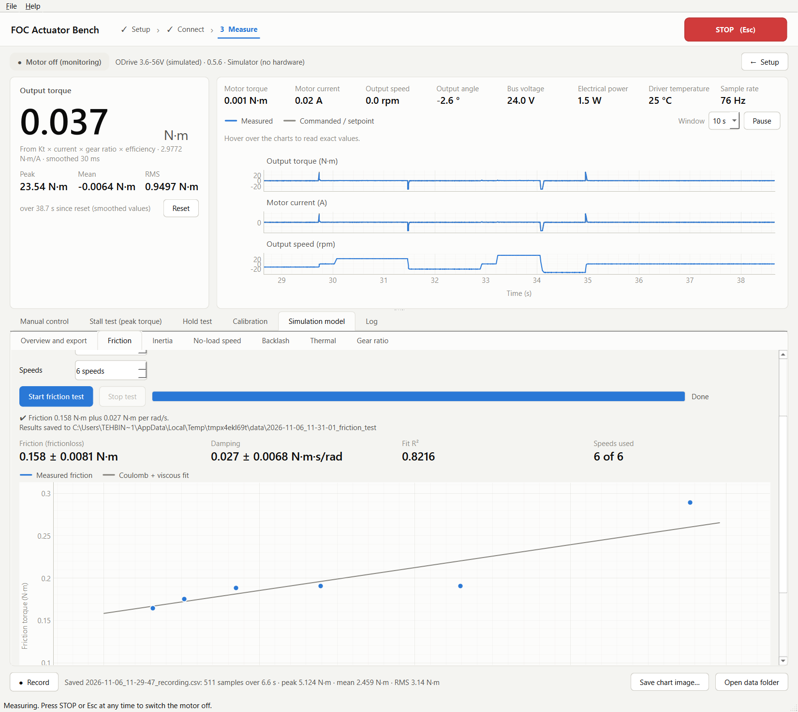
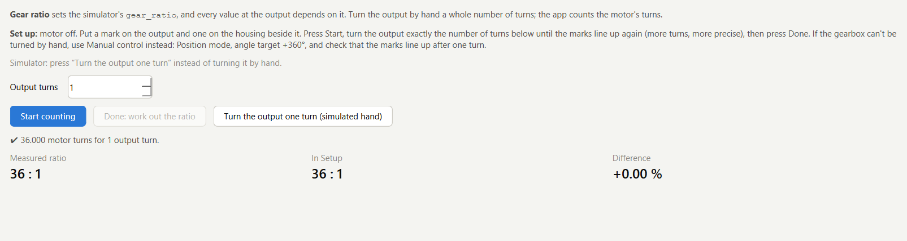
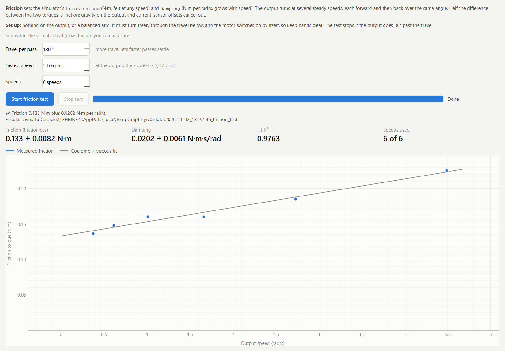
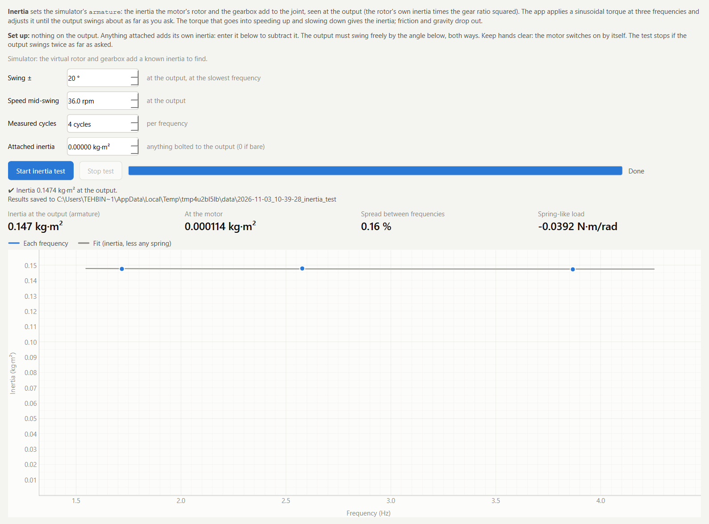
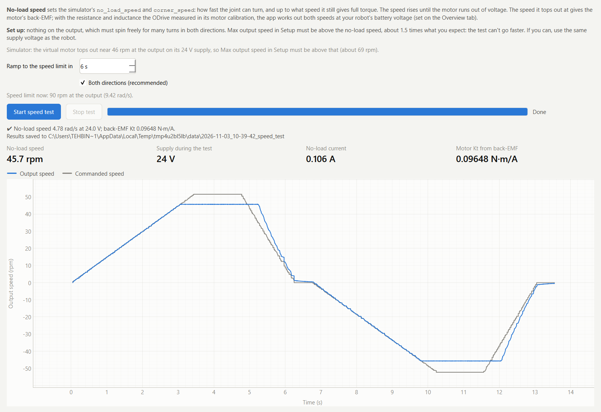
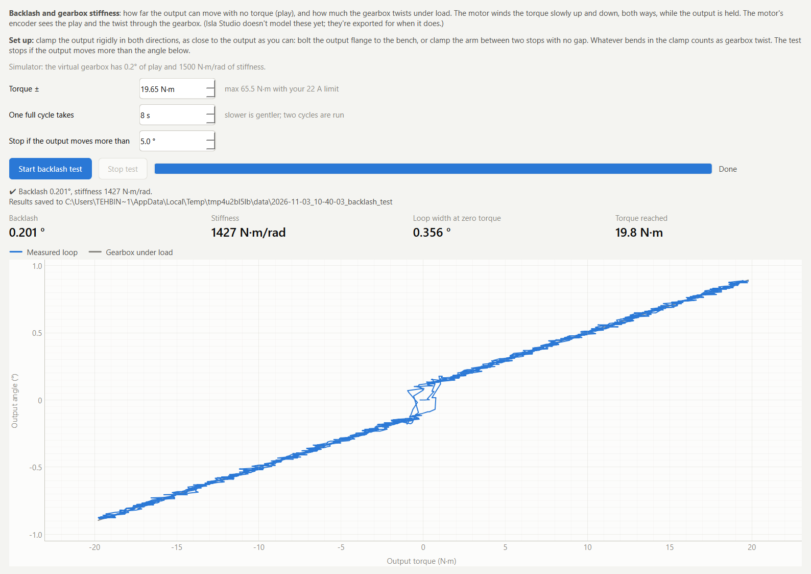
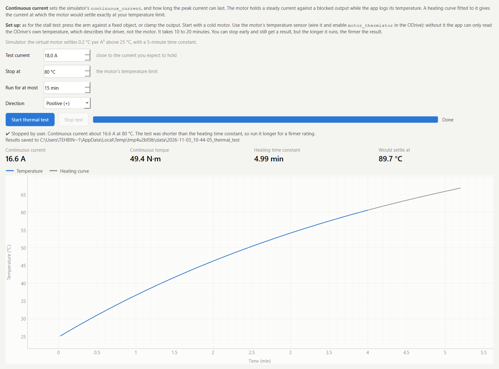
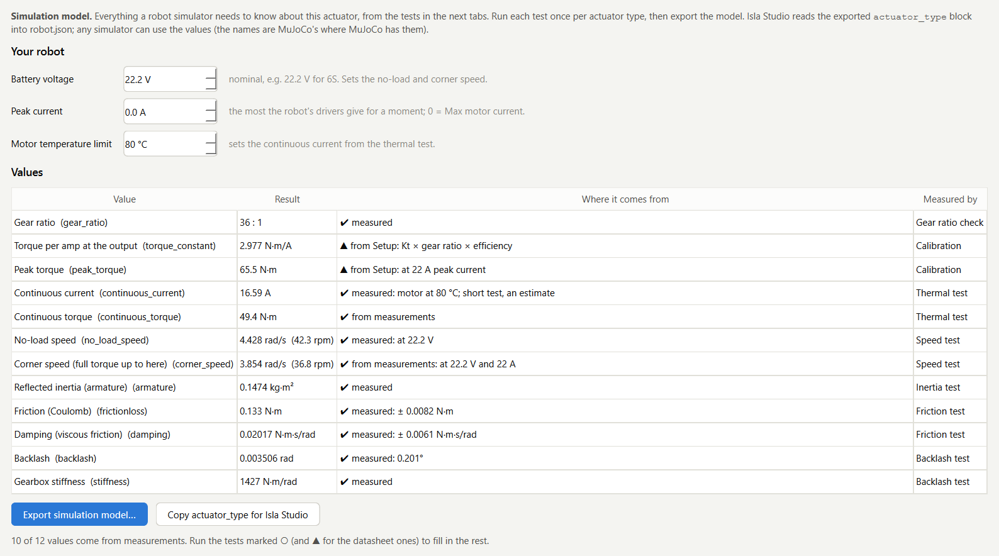

# Measuring an actuator for robot simulation

A robot learns to walk in simulation first. The simulator can only be as good as what it knows
about each joint's actuator: how much torque it gives, how fast it turns, how heavy its rotor feels,
how much it rubs, how much play its gearbox has, and how long it can hold a load before it gets too
hot. Datasheets give some of these values roughly, and most of the others are guesses. A policy
trained on guesses learns to rely on them, and then falls over on the real robot.

The **Simulation model** tab measures these values on the bench and exports them in one file.

## What gets measured

| Value | Simulator field | Measured by | Takes | Output must be |
|---|---|---|---|---|
| Gear ratio | `gear_ratio` | Gear ratio check | 1 min | turned by hand |
| Torque per amp at the output | `torque_constant` | Calibration | 10 min | an arm with weights |
| Peak torque | `peak_torque` | Calibration × peak current | | |
| Continuous current | `continuous_current` | Thermal test | 15–20 min | blocked |
| No-load speed | `no_load_speed` | No-load speed test | 1 min | free to spin |
| Corner speed | `corner_speed` | No-load speed test (calculated) | | |
| Reflected inertia | `armature` | Inertia test | 1 min | free, ±20° |
| Friction | `frictionloss` | Friction test | 1–2 min | free, 180° |
| Damping | `damping` | Friction test | | |
| Backlash | `backlash` | Backlash test | 1 min | clamped both ways |
| Gearbox stiffness | `stiffness` | Backlash test | | |

All values are at the actuator's **output**, after the gearbox, in SI units: N·m, rad/s, kg·m²,
N·m per rad/s, rad and N·m/rad. The field names are MuJoCo's where MuJoCo has the value, and match
[Isla Studio](https://github.com/Isla-Technologies/isla-studio)'s `robot.json`.

What the values mean to a simulator:

- **Torque per amp** turns the motor current into joint torque. Every torque the app shows uses it,
  so measure it first.
- **Peak torque** is the most the joint gives for a moment: torque per amp × the peak current the
  robot's drivers allow.
- **Continuous current** is the current the motor can hold forever without passing its temperature
  limit. Above it, it can only work in bursts.
- **No-load speed** is the speed at which the motor runs out of voltage and gives no more torque.
  **Corner speed** is the speed up to which it still gives full torque. Between the two, the torque
  falls. These two usually limit running and jumping more than the torque does.
- **Armature** is the inertia the motor's rotor and the gearbox add to the joint. A small rotor
  turning 36 times faster than the joint feels 36² = 1296 times heavier at the joint, often more
  than the leg segment itself.
- **Friction** (`frictionloss`) is felt at any speed and holds the joint still under small loads.
  **Damping** grows with speed.
- **Backlash** is the play in the gearbox, and **stiffness** is how much it twists under load. Most
  simulators assume a rigid gearbox with no play; the values are measured so you know how far that
  is from the truth.

## Before you start

You need:

- A controller for the actuator:
  - an **ODrive V3.6**, or a board running the same firmware such as the MKS ODrive S, with firmware
    **0.5.x**. The motor and encoder must already be calibrated on it (they work in odrivetool). The
    app reads the motor's resistance and inductance that this calibration measured; or
  - a **SimpleFOC board** such as an ESP32 FOC driver, best with the bench firmware: see
    [Measuring an actuator on a SimpleFOC board](simplefoc.md). Enter the motor's pole pairs, phase
    resistance and inductance in Setup if the sketch doesn't set them.
- A **DC supply**, ideally at the robot's battery voltage. The no-load speed test scales its result
  to the battery voltage you enter, but the closer the supply, the smaller the correction.
- A way to **clamp the actuator** to the bench. The tests switch the motor on by themselves.
- For the calibration: a **rigid arm** of known length and two or three **known weights**.
- For the backlash test: a way to **lock the output** in both directions (bolt the output flange to
  the bench, or clamp the arm between two stops with no gap).
- For the thermal test: the motor's **temperature sensor**, wired to the ODrive and enabled
  (`axisN.motor.motor_thermistor.config.enabled = True` with its coefficients, in odrivetool), or
  set up in the SimpleFOC bench firmware. Without it the app falls back to the driver's own
  temperature, which describes the driver, not the motor.

In **Setup**, make one profile per actuator and enter its values, including the controller it is
on. Set **Max output speed** to about 1.5 times the no-load speed you expect: the no-load speed
test can't go faster than this limit.

## The order to run the tests

Run them on one profile per actuator type, in this order. Every result is saved on the profile as
soon as a test finishes, so you can stop and continue another day.

1. **Gear ratio check.** Every value at the output depends on the ratio.
2. **Calibration** (the existing Calibration tab). Every torque reading after this uses the measured
   torque per amp, so friction, inertia, backlash and the continuous torque all get more accurate.
3. **Friction test**
4. **Inertia test**
5. **No-load speed test**
6. **Backlash test**
7. **Thermal test** last: it heats the motor, and a hot motor has more resistance and different
   friction. Let it cool down before measuring anything else.

Then open **Overview and export**, enter your robot's values and export the model.

## Gear ratio check

**Measures:** the real gear ratio, by counting motor turns while you turn the output by hand.

1. Switch the motor off. Put a mark on the output and one on the housing beside it.
2. Enter how many whole output turns you'll make (more turns give a more precise ratio).
3. Press **Start counting**, turn the output that many turns until the marks line up again, and
   press **Done**.

The result shows the measured ratio and how far it is from the one in Setup. If it differs by more
than a fraction of a percent, correct the gear ratio in Setup before going on.

**If the gearbox can't be turned by hand:** use Manual control in Position mode, set the angle
target 360° further on, and check that the marks line up after one output turn.

## Calibration (torque per amp)

The existing **Calibration** tab: a rigid arm of known length, two or three known weights, slow
sweeps through horizontal. See the [README](../README.md#3--measure). It measures the real output
torque per amp, which includes the gearbox's losses and any error in the motor's datasheet KV.

**For a robot:** use weights heavy enough to reach a good share of the robot's working torque. A
calibration with 1 kg on a 0.3 m arm (3 N·m) says nothing about how the actuator behaves at 40 N·m.
Motors saturate magnetically at high current, and that only shows with heavy weights: if the points
stop lying on a straight line at the heavy end, the peak torque is lower than current × torque per
amp suggests.

## Friction test

**Measures:** `frictionloss` (Coulomb friction, N·m) and `damping` (viscous friction, N·m per rad/s).

**How:** the output turns at several steady speeds, from 1/12 of the fastest up to the fastest.
Each speed runs forward, then back over the same angle. Half the difference between the forward
and backward torque is friction; whatever doesn't depend on the direction (gravity on the output,
a current-sensor offset) cancels out. A straight line through friction against speed gives
Coulomb friction (where it meets zero speed) and damping (its slope).

**Set up:** nothing on the output, or a balanced arm. The output must turn freely through the travel
(180° by default; more is better if nothing is in the way).

**Settings:**

- *Travel per pass*: how far each pass turns. The fastest pass needs about 0.7 s to settle, so a
  short travel lowers the top speed the test can use.
- *Fastest speed*: up to about 60 % of the no-load speed. Friction at walking and running speeds
  matters most.

**Result:** friction and damping, the fit's R² (close to 1 means the straight line describes the
friction well), and a chart of friction against speed with the fitted line.

**Stops by itself** if the output goes 30° past the travel.

## Inertia test

**Measures:** `armature`, the inertia the rotor and gearbox add to the joint, at the output.

**How:** the app applies a sinusoidal torque at three frequencies and raises or lowers it, cycle by
cycle, until the output swings about as far as you asked. Then it measures four cycles at that
torque. Over whole cycles, the torque in step with the speed is friction, and the torque a quarter
cycle ahead of it is what speeds the output up and slows it down: inertia. Comparing three
frequencies also separates anything spring-like, such as gravity on a slightly unbalanced output.
A weak centring spring keeps the output from wandering; it's part of the measured torque, so it
doesn't affect the result.

**Set up:** nothing on the output. Anything attached adds its own inertia; if something has to stay
on (a coupling, a flange), enter its inertia under *Attached inertia* and it is subtracted. The
output must swing freely by the swing angle both ways.

**Settings:** *Swing ±* (20° by default) and *Speed mid-swing* (40 % of the speed limit). Faster
swings make the inertia's share of the torque larger compared with friction, which makes the result
more precise.

**Result:** inertia at the output (the simulator's armature), the same at the motor (divided by the
gear ratio squared, to compare with the rotor's datasheet inertia), the spread between the three
frequencies, and the spring-like load. A spread above 15 % means something rubs or hangs on the
output.

**Stops by itself** if the output swings more than twice as far as asked.

## No-load speed test

**Measures:** `no_load_speed` and `corner_speed` at your robot's battery voltage, and the motor's
back-EMF constant.

**How:** in speed control, the commanded speed rises slowly. When the motor runs out of voltage,
its speed stops following the command; the app holds there, averages the speed, the current and the
supply voltage, then slows down and does the same in the other direction. The speed it topped out at
gives the motor's back-EMF constant (its real Kt, independent of the gearbox). With the phase
resistance and inductance (measured by the ODrive in its motor calibration; for a SimpleFOC board,
the sketch's values or those in Setup), the app then works out:

- the **no-load speed** at the battery voltage you enter on the Overview: where the motor gives no
  torque at all;
- the **corner speed** at that voltage and the peak current: the fastest the joint turns while still
  giving full torque.

**Set up:** nothing on the output, which must spin freely for many turns in both directions. Set
Max output speed in Setup above the speed you expect, about 1.5 times: the test can't go faster.

**Result:** the no-load speed at the test's supply voltage, the supply voltage, the no-load current
and the motor's Kt from its back-EMF. If the motor reached the speed limit first, the test says so:
raise Max output speed and run it again.

**Stops by itself** if the output doesn't turn (current near the limit but no speed).

## Backlash test

**Measures:** `backlash` (the gearbox's play) and `stiffness` (how much it twists per N·m).

**How:** with the output locked, the torque rises slowly to the test torque, falls to the same torque
the other way, and comes back, twice. The motor's encoder sees the motor turn through the play and
then twist the gearbox. The chart shows output angle against torque: a loop. The steep middle of the
loop is the play; the slope of its loaded ends is the stiffness. Each half of the loop is fitted
separately, away from the reversals, so friction doesn't bias the result.

**Set up:** lock the output rigidly in **both** directions, as close to the output as you can.
Whatever bends in the clamp counts as gearbox twist, so a flexible clamp makes the gearbox look
softer than it is.

**Settings:** *Torque ±* (30 % of the most your current limit allows) and the cycle time.

**Result:** backlash in degrees, stiffness in N·m/rad (both directions averaged), the loop's width at
zero torque (play plus friction), and the torque reached.

**Stops by itself** if the output moves more than the allowed angle (5° by default): it isn't
locked.

## Thermal test

**Measures:** `continuous_current`: the current at which the motor would settle exactly at its
temperature limit. Also how long the peak current can last from cold (in the export).

**How:** the motor holds a steady current against a blocked output while the app logs the
temperature every half second. It stops at the temperature limit, at the time limit, or when you
press **Stop test**. A first-order heating curve (start temperature + rise × (1 − e^(−t/τ))) fitted
to the readings gives how far the temperature would rise at this current, and how fast. Heat grows
with the current squared, so the continuous current is test current × √(allowed rise / rise).

**Set up:** as for the stall test: press the arm against a fixed object, or lock the output. Start
with a cold motor. Use the motor's temperature sensor.

**Settings:** *Test current* (close to what you expect the joint to hold), *Stop at* (the motor's
temperature limit: check its winding insulation class), *Run for at most*.

**Result:** continuous current and torque, the heating time constant, and the temperature it would
settle at. If the test was shorter than the time constant, the result is an estimate: run it
longer, or at a higher current, for a firmer number.

**Stops by itself** at the temperature limit, at the time limit, or if the arm moves.

## Overview and export

Enter your robot's values:

- **Battery voltage**: the nominal voltage the robot's drivers run on, e.g. 22.2 V for a 6S
  lithium pack. It sets the no-load and corner speed.
- **Peak current**: the most current the robot's drivers give for a moment. 0 uses Max motor
  current from Setup.
- **Motor temperature limit**: sets the continuous current from the thermal test.

The table lists every value, its result and where it came from:

- **✔ measured**: from a test on this actuator.
- **✔ from measurements**: calculated from measured values (peak torque, corner speed).
- **▲ from Setup**: typed in from a datasheet, not measured.
- **○ not measured**: no test has run yet.

**Export simulation model…** saves a JSON file. Its `actuator_type` block holds only measured
values, so it never replaces a simulator's numbers with guesses; it can be pasted into an actuator
type in Isla Studio's `robot.json`. **Copy actuator_type for Isla Studio** copies just that block.

The file also holds:

- `not_measured`: what is still missing;
- `values`: every value with its source;
- `extra`: the motor's electrical constants, the full torque-speed curve, the gearbox efficiency
  worked out from the back-EMF, the thermal fit and how long the peak current can last;
- `tests`: every test's result with its date.

## Limitations

- **The controller measures current, not torque.** The calibration turns current into torque with a
  few percent accuracy at the loads it was done with. At much higher currents motors saturate, so
  the real peak torque can be lower than the calculation; only a calibration with heavy weights, or
  a load cell, shows this.
- **The no-load and corner speed depend on the driver.** ODrive firmware 0.5.x gives the motor at
  most 80 % of the voltage space-vector modulation could. A SimpleFOC board gives at most its
  `voltage_limit`, and 1/√3 of the supply with space-vector modulation (1/2 with sine). The export
  works the speeds out for the driver the actuator was measured on (`conditions` in the file says
  which); if the robot's drivers use more or less of the battery voltage, the speeds scale with it.
  The export includes the motor's back-EMF constant, resistance and inductance so they can be
  recalculated for another driver.
- **The corner speed is calculated, not measured.** Measuring torque at speed needs a second motor
  as a brake (a dynamometer). The calculation uses the standard motor model with the measured
  back-EMF, resistance and inductance, without field weakening.
- **Friction is modelled as Coulomb plus viscous.** Very low-speed effects (stiction bigger than the
  sliding friction, the Stribeck effect) and friction that changes with the angle (cogging, a tight
  spot in the gearbox) aren't captured. Friction also changes with temperature and with the load
  on the gearbox; the test measures it unloaded at room temperature.
- **Backlash and stiffness are seen through the motor's encoder.** They include everything between
  the motor and the clamp: gearbox, bearings, output flange and the clamp itself.
- **The thermal test heats a stalled motor.** At standstill the current flows mostly through one or
  two phases, so they get hotter than in a turning motor. The continuous current is therefore on the
  safe side for a walking robot. With only the driver's temperature, it describes the driver, not
  the motor.
- **What the bench can't measure:** the control delay of the robot's own communication (CAN bus,
  computer) and the robot's battery sag under load. Measure those on the robot.

## How accurate it is

In the simulator, where the true values are known, the tests recover them on actuators from 9:1 to
54:1, including ones the size of Luma-1's (36:1 with heavy friction, 54.5:1 with a light rotor):

| Value | Error in the simulator |
|---|---|
| Friction, damping | 1 %, 3 % |
| Reflected inertia | 2 % |
| Back-EMF constant, no-load speed | under 1 % |
| Backlash, stiffness | 0.01°, 1 % |
| Continuous current | under 1 % |

That last number flatters the thermal test: the simulated motor heats like one simple body, but a
real one doesn't. Its windings heat quickly and its housing slowly, so a short test sees only the
fast part and overestimates the continuous current. Run it for at least one time constant (the app
says when it was shorter).

On real hardware, the torque scale usually dominates: everything measured in N·m is as accurate as
the torque per amp, so do the calibration first, with heavy weights.

## Luma-1

Luma-1 uses two actuator types. Make one profile for each:

| Setup field | Macro actuator | Micro actuator |
|---|---|---|
| Profile name | Luma-1 macro | Luma-1 micro |
| Motor | KV 90 | Kt 0.02494 N·m/A |
| Gear ratio | 36 | 54.538 (7.385²) |
| Gearbox efficiency | 90 % | 100 % |
| Max motor current | 22 A | 17.2 A |
| Max output speed | 90 rpm | 200 rpm |

These reproduce the robot's current figures (3.0 and 1.36 N·m/A at the output) until the
calibration replaces them. On the Overview, enter a battery voltage of 22.2 V (6S).

The micro actuator normally runs on its own ESP32 SimpleFOC board, and can be measured on it: flash
the bench firmware with its AS5047P encoder selected (see [the SimpleFOC guide](simplefoc.md)) and
choose **SimpleFOC board** in its profile. Its no-load and corner speed then come from the board it
will run on. Measuring it on an ODrive also works (firmware 0.5.x reads the AS5047P over SPI,
`encoder.config.mode = ENCODER_MODE_SPI_ABS_AMS`): everything mechanical (friction, inertia,
backlash, stiffness, gear ratio) and the motor's own constants carry over, but the speeds then
describe the ODrive's voltage; see Limitations.

Export one model per actuator type and send both files.
